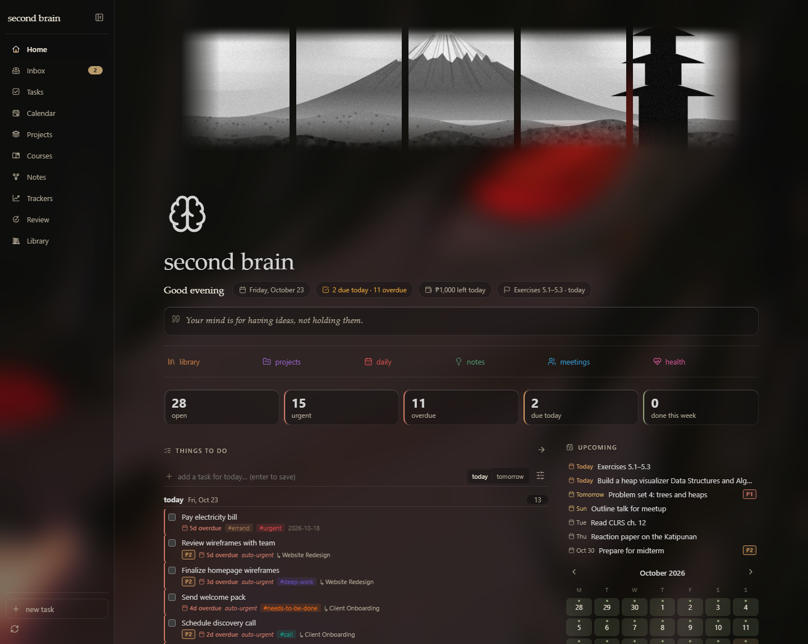
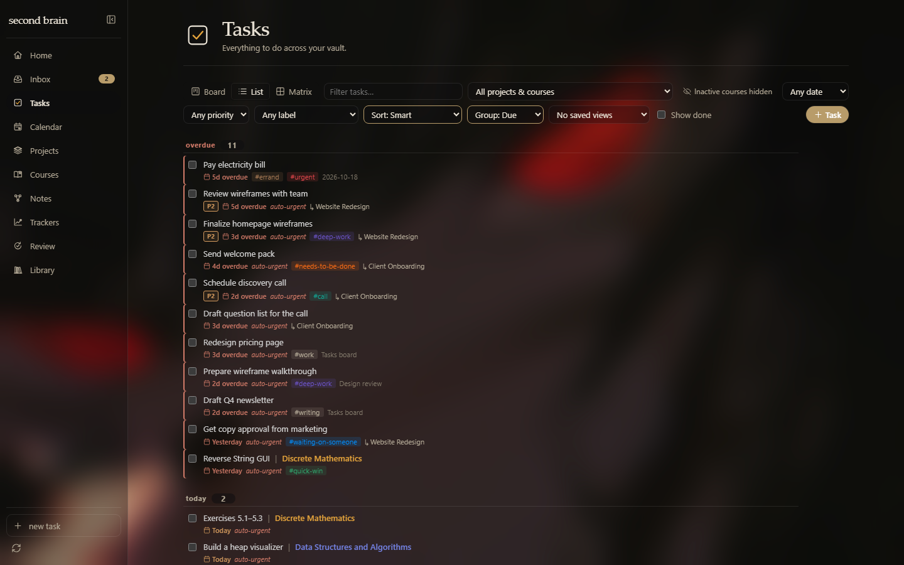
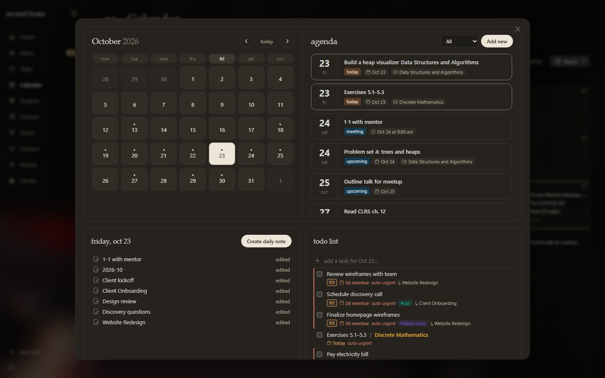
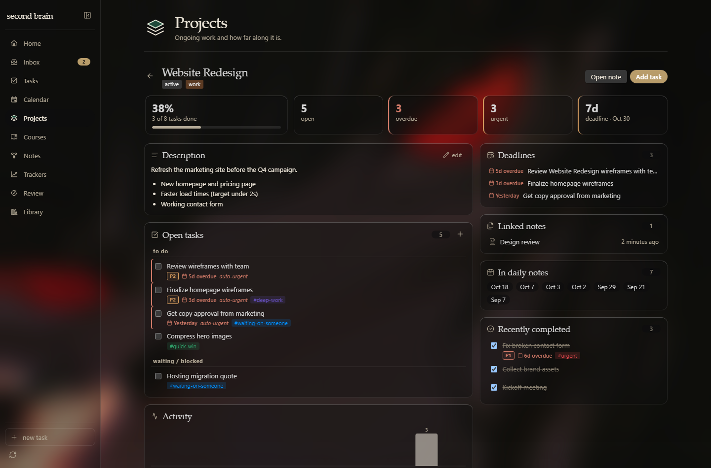
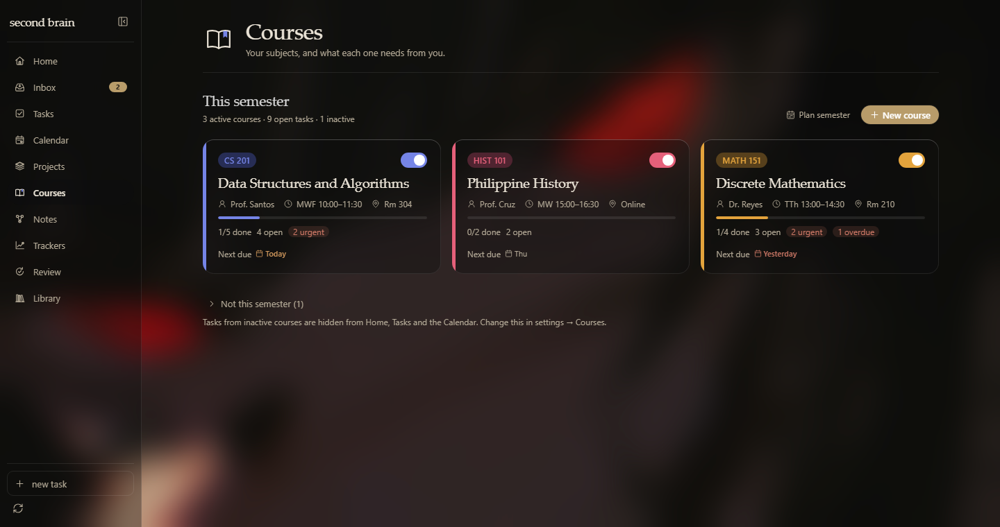
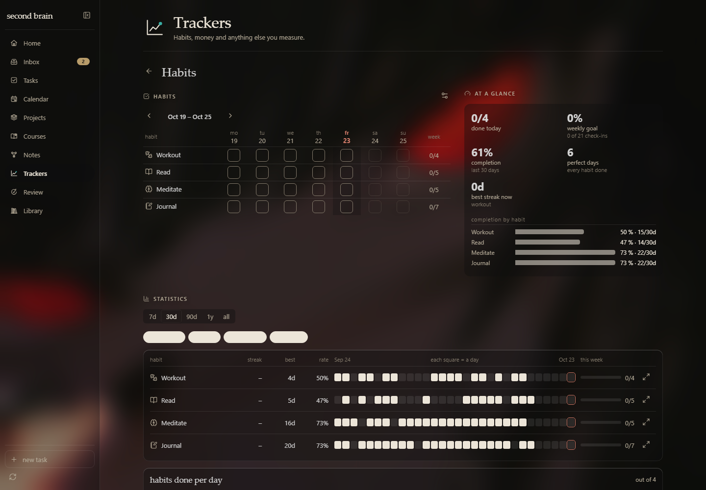
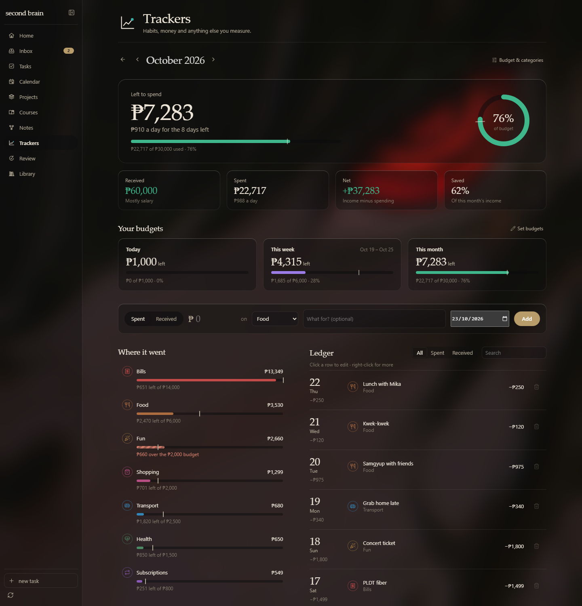
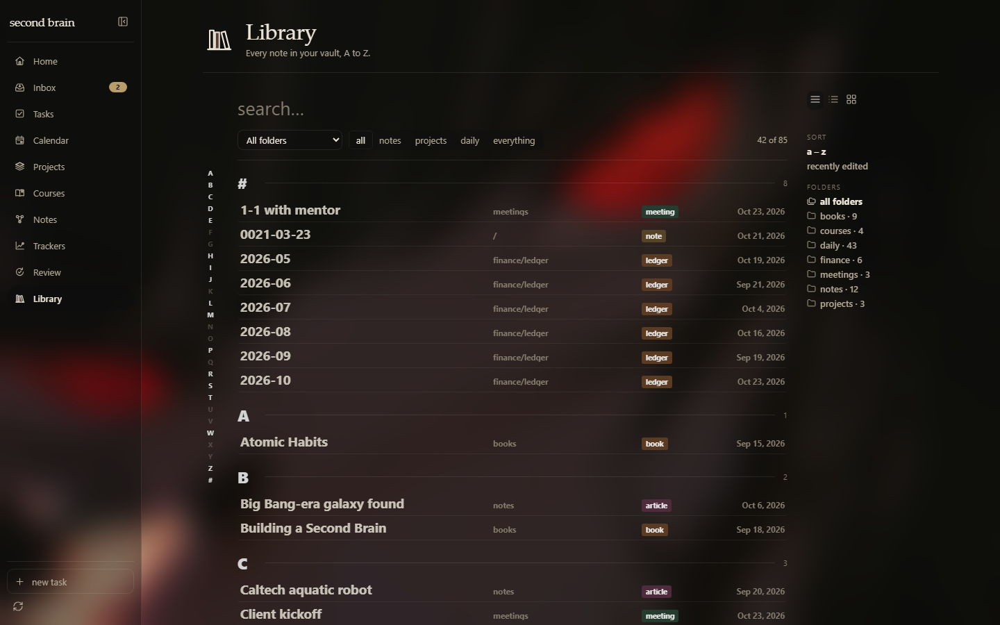
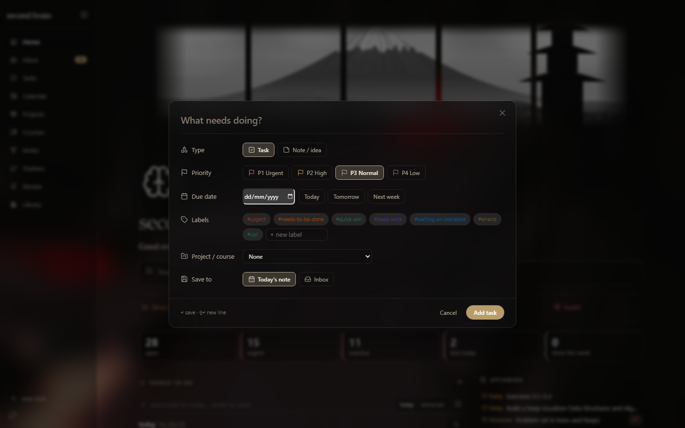
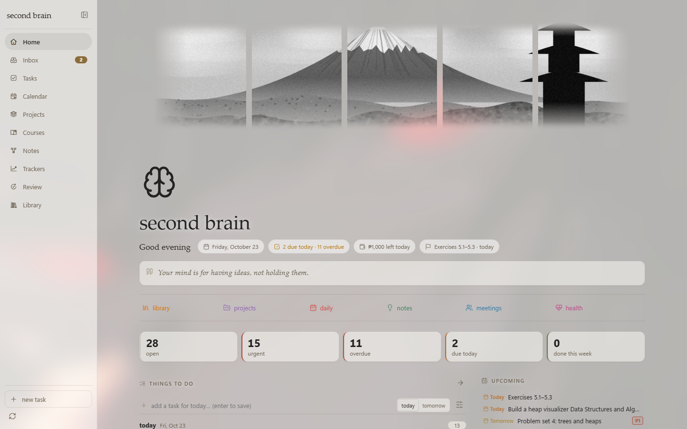

# joejoe's second brain

A full-page dashboard for [Obsidian](https://obsidian.md) that turns the vault you already have into a second brain: tasks on a Kanban board, a calendar with a day planner, projects and school courses with their own pages, habits and money tracking with statistics, an inbox, Zettelkasten tools, a weekly review, an encrypted secrets vault, and an A–Z library of every note. Everything is connected, and everything stays in plain Markdown.

It doesn't ask you to reorganize anything. It reads the notes, tasks and frontmatter you already write, and when you act on the dashboard (tick a task, drag a card, check a habit, log an expense) it writes the change back to the same Markdown line, table or property you'd have edited by hand.



*Screenshots use the Gallery style, the Joejoe Gallery theme and [Glass mode](#look-and-feel) with a wallpaper.*

---

## Contents

- [Features](#features)
- [Look and feel](#look-and-feel)
- [Install](#install)
- [Getting started](#getting-started)
- [How your notes map to the dashboard](#how-your-notes-map-to-the-dashboard)
- [Settings](#settings)
- [Commands](#commands)
- [Development](#development)
- [Project structure](#project-structure)
- [Roadmap](#roadmap)
- [License](#license)

---

## Features

### Navigation
- **Sidebar:** every page is one click away in a left sidebar with custom thin-line icons. Collapse it to icons with the button at the top; it also collapses by itself on narrow windows. **New task** and **rebuild index** sit at the bottom, and Inbox shows a count badge.
- **Page headers:** every page except Home opens with its icon, its name and a one-line description.
- **Comfortable width:** pages are limited to a readable width. The calendar and the Kanban board can use more.

### Home: a page you can make your own
- **Cover:** pick an image from your vault, upload one, paste a link, or drop/paste a file (GIFs animate). There are four cover layouts, switched from the toolbar that appears when you hover the cover:
  - **Blended:** the image melts into the page and the title sits beside it. Dark backgrounds disappear into the page, and the image's own edges feather out, so moved or narrow photos never show a seam. In light mode, art made for dark pages keeps a soft dark backdrop.
  - **Panels:** the image split into five black-and-white panels with gaps that show the page. With no image, it draws a black-and-white mountain landscape.
  - **Single:** one image across the top.
  - **Editorial:** a big title over an image band, with today's quote, an outlined date and today's facts.
- **Reposition:** drag the image in any direction, rotate it (±45°) and zoom it (100–250%) with sliders, arrow keys, `[` `]`, `+` `−` or the scroll wheel. **Reset**, **Cancel** (Esc) and **Save** (Enter). Every cover change can be undone from the notice it shows.
- **Page header:** a page icon (emoji, any [Lucide](https://lucide.dev) icon, or an image), the title, and a daily quote, all editable in place. An **at-a-glance** row shows a greeting, today's date, tasks due today and overdue, money left today, and the next deadline. Each chip opens the matching page, and each can be switched off.
- **Quick links** to folders, notes, `#tags` or websites.
- **Things to do:** urgent, overdue and due-today tasks with quick add and a today/tomorrow switch, next to **upcoming** deadlines, a mini calendar (accent for due days, green for days with notes) and today's daily note.
- **Money:** total spent this month against your budget, today's and this week's budgets, received / net / per day, a quick log (`250 food lunch`), your latest entries (edit, delete, right-click), and a link to the Money page.
- **Habits** for today as checkboxes, or this week's grid.
- **Widgets:** a countdown, year/month/week/day progress, a flip clock, a pixel field, and your own **images**.
- **Notebook** (recently edited / due soon / check again), a **projects** column, and the **knowledge lab** (areas, tags or folders).
- **Customize page:** reorder or hide any section, toggle widgets and at-a-glance chips, and change the look.

### Tasks: your Kanban plugin board

- **Board:** one board file in the [Kanban plugin's](https://github.com/mgmeyers/obsidian-kanban) format. Pick an existing board or create one; the same file still opens in the Kanban plugin. Drag cards between lists or reorder them, tick them complete, add cards, double-click to edit, set dates (`@{2026-10-20}`), and add, rename, move or delete lists.
- **List:** tasks found across your notes, with filters (project or course, due date, priority, label), grouping and sorting, and **saved views**.
- **Matrix:** an Eisenhower urgent/important grid.
- Course tasks read **task | Course name**, with the course name in its colour.
- **Create a task** from anywhere with **Ctrl/Cmd+Alt+N**, the ribbon button, the sidebar, or the command palette.

### Calendar and day planner

- **Month, week and timeline** views, with layers you can toggle: tasks due, scheduled and done; project and note deadlines; meetings (any note with `date:` / `time:` in its frontmatter); daily notes; notes created and edited.
- Drag a task onto a day to set its due date.
- **Click any date** to open the day popup: a month grid, the day's agenda and what's coming up, plus that day's notes and a todo list with quick add.

### Projects

- Project cards showing progress, open/urgent/overdue counts, the next due date and the deadline. **New project** creates the note for you.
- Each project gets its own page: a stat strip, an **editable description** (saved to the note's `description` property), open tasks by status, weekly activity, deadlines, linked notes, daily-note mentions and recently completed tasks.

### Courses (school)

Your subjects, each with a code, instructor, schedule, room, units, semester and colour. They work like projects, and each can be **active** or **inactive** for the semester.
- **Courses tab:** cards for *This semester* and, collapsed, *Not this semester*. Each card has a progress bar, open/urgent/overdue counts, the next due date, a quick **+** to add a task, and an **Active** switch. Right-click a card for more.
- **Plan semester:** name the term and tick the courses you're taking. Everything else goes inactive, and the term is written onto the ticked courses.
- **Course page:** the project page with the course details on top, plus **Mark active / inactive** and **Edit details**.
- **Tasks belong to a course** when they're in the course note or its folder, link `[[Course]]`, sit in a note with `course: …` in its properties, or are tagged with the course code (`#cs201`).
- **Inactive courses stay out of the way:** their tasks are hidden from Home, Tasks, the Calendar and Review (a setting, also toggled from the Tasks toolbar), but always show on the course page.

### Trackers: habits, money and more

- **Trackers home:** a card for **Habits** (done today, the last seven days, this week's %, perfect-day streak) and one for **Money** (left this month, budget bar, spent / received / net, category strip), then any other trackers.
- **Habits:** tick any day in the week grid; each tick writes `habit: true` / `false` into that day's daily note. **At a glance** (done today, weekly goal, completion, perfect days, streaks), and **statistics** across every habit (7d–all, streak / best / rate, heatmap strips, a habits-per-day chart, and a 12-month focus view per habit).
- **Other trackers** for numbers or stages (weight, workouts, job applications…) read from daily-note fields, one note per item, or a Markdown table, and give you totals, trends, funnels, goals and an entries table.

### Money: income and expenses

A monthly view of what came in and what went out (PHP by default).
- **Summary first:** *Left to spend* in large type with the per-day allowance, a budget bar and a budget ring with an even-pace marker, then Received, Spent, Net and Saved %.
- **Your budgets:** **Today**, **This week** and **This month**, each against its own budget, with a meter that turns amber near the limit and red when over.
- **Quick add** reads like a sentence: *Spent / Received ₱[amount] on [category] · [note] · [date]*. Typing `250 food lunch` or `+52000 salary` fills in the rest. Every add can be undone.
- **Where it went** (categories largest first, with budget markers and "₱X left / over" written out), **Biggest expenses**, and **Where it came from**.
- **Ledger:** grouped by day with daily totals, filters and search. Every row has a **delete** button (undoable) and a **right-click** menu: edit, duplicate for today, move to another category, delete.
- **Charts:** the month as a running curve against your budget pace with a month-end projection, **share by category** (donut), **day by day** (stacked by category), **last six months** (in vs out), and **by weekday**.
- **Budget & categories:** daily, weekly and monthly budgets, budgets per category, and categories and income sources with 18 colours and 40 icons.
- **Storage:** plain Markdown, one table per month in `Finance/Ledger/YYYY-MM.md`, editable by hand.

### Library

- An A–Z index of every note, grouped under letter headers with folder, type and date in aligned columns. Sorted by recent, it groups by month.
- Filter by folder (including subfolders), type, tag or area; the letter rail jumps between groups. Three views: large index, notebook list, and cards.

### Quick capture

- Every field visible at once: title, task or note, priority, due date (with Today / Tomorrow / Next week), labels with an inline *new label* field, project or course (this semester's courses first), and where to save (today's note, Inbox, or the project's or course's note).

### Inbox triage
- Captured tasks (your Inbox file) and fleeting notes (the fleeting-notes folder) wait in one queue, with a count badge in the sidebar.
- Work through them one at a time. For a task: set priority, due date, labels and project, then **move to the project**, **move to today's note**, mark **done**, or **delete**. For a fleeting note: **make it a permanent note** or a **literature note**, move it into a project folder, or delete it.

### Notes: Zettelkasten tools
- **Create** fleeting, literature (book / article / video / podcast) and permanent notes from your templates (`Fleeting note.md`, `Literature note.md`, `Permanent note.md` in your templates folder, with `{{title}}`, `{{date}}` and `{{time}}`). Permanent notes can get a `YYYYMMDDHHmm` id.
- **Orphans** with **link suggestions** and one-click **+ link**, a daily **resurface** pick, and **split into atomic notes** for the last note you opened.

### Weekly review
- Any week at a glance: tasks done, slipped tasks (move them all to tomorrow in one click), project progress, habits, notes written, inbox count and orphans.
- A checklist and reflections, saved per week. **Write review note** saves everything to `Reviews/2026-W43.md`.

### Secrets vault
A small password manager for API keys, tokens (PATs), logins and secure notes, so they never end up in a note or a repo.
- **Encrypted at rest:** AES-256-GCM, with the key derived from one master password (PBKDF2-SHA256, 600,000 iterations, random salt, fresh nonce on every save). Only ciphertext is written; nothing goes into `data.json`, the index or the console.
- **Kept outside your vault by default** (`%APPDATA%\joejoe-secrets\vault.enc` on Windows). If you move it into a git repository, it's added to that repo's `.gitignore` and you'll see a warning.
- **Two-pane manager** with masked values, custom fields and encrypted notes. **Locks itself** after 5 idle minutes and when Obsidian closes; **copied secrets are cleared** from the clipboard after 30 seconds.
- Atomic saves with a `vault.enc.bak` backup. There is no password recovery. Desktop only.

---

## Look and feel



- **Page styles:** *Mono* (a Notion-like monospace page), *Gallery* (warm espresso and parchment with serif titles) or *Theme native* (your theme's fonts). **Dark mode surfaces:** theme default, darker, plain or black.
- **Glass mode:** a wallpaper behind all of Obsidian, with every pane frosted on top of it (editor, sidebars, tabs, the dashboard, modals and menus). It works on any system and any theme, with no OS setting needed. You can set the wallpaper (it defaults to your cover image), **tint** (neutral, cool or warm), **frost**, **pane opacity**, **card opacity** and **dim**. Light mode gets warm-white frost with visible edges.
- **Background noise:** animated film grain with **intensity**, **grain size** and **movement** (0 = still).
- **Background grid:** a faint square grid (off by default).
- **Pixel effects:** ordered (Bayer) dithering, each toggleable: a **pixel field** widget (move the mouse to light it, click for ripples), **dissolve transitions** between pages, and a `dither` code block for your notes:

  ````markdown
  ```dither
  src: Attachments/photo.png
  palette: gameboy
  pixel: 3
  height: 240
  ```
  ````
  Leave out `src` to get a pixel field. Palettes: `theme`, `gameboy`, `amber`, `ice` and `rose`.
- **Motion** responds to what you do, and all of it turns off when your system asks for reduced motion.

### Companion theme: Joejoe Gallery
An Obsidian theme for the whole app (in `theme/Joejoe Gallery/`).
- **Colours:** warm espresso in dark mode, parchment in light mode, soft gold accents.
- **Type:** serif titles and headings over an Inter / Segoe UI body; headings 4–6 and table headers as small spaced-out capitals.
- **Code blocks** in a VS Code (Dark+ / Light+) palette: purple keywords, yellow functions, orange strings, teal types, light-blue variables, gray italic comments, on a near-black block.
- **Frosted** modals, menus, the command palette, suggestions and notices. If your system offers Obsidian's *Translucent window* setting, the theme supports it too.
- **Install:** `npm run deploy -- "<vault>"` installs it next to the plugin. Then pick **Joejoe Gallery** under *Settings → Appearance → Themes*.

---

## Install

### Manual (until it's in the community store)

1. Download `main.js`, `manifest.json` and `styles.css` from the latest release (or build them, see [Development](#development)).
2. Create the folder `<your vault>/.obsidian/plugins/second-brain-dashboard/` and put the three files in it.
3. In Obsidian: **Settings → Community plugins** → turn off Restricted mode if needed → enable **joejoe's second brain**.

### With BRAT

Install the [BRAT](https://github.com/TfTHacker/obsidian42-brat) plugin, choose *Add beta plugin*, and paste this repository's URL.

### From source

```bash
npm install
npm run build
npm run deploy -- "/path/to/YourVault"   # plugin + the Joejoe Gallery theme
```

---

## Getting started

1. Click the **dashboard** icon in the left ribbon, or run **joejoe's second brain: Open dashboard**.
2. Open **Settings → joejoe's second brain** and tell it where things are:
   - **Projects:** a folder (default `Projects/`), a tag (`#project`), or a frontmatter field (`type: project`).
   - **Courses:** a folder (default `Courses/`), a tag (`#course`), or `type: course`, and the current semester's name.
   - **Daily notes:** uses the core Daily Notes plugin's folder and format when that plugin is on; otherwise set them here. Habit ticks are saved in daily notes.
   - **Inbox, Zettelkasten and review folders**, and **excluded folders** (templates, attachments, Excalidraw…).
3. Open **Tasks** and pick (or create) the Kanban board to use.
4. Add a few habits from **Trackers → Habits**, set budgets under **Trackers → Money → Budget & categories**, and hover the top of Home to set an icon and a cover.

To see everything filled in first, open the bundled `demo-vault/` folder as a vault (projects, courses, six weeks of habit data, months of money, meetings and tasks in every supported syntax).

---

## How your notes map to the dashboard

### Tasks

Plain Markdown checkboxes, compatible with the **Tasks** and **Dataview** plugins (neither is required):

```markdown
- [ ] Send invoice #urgent #needs-to-be-done [[Client A]] ⏫ 📅 2026-10-20
- [/] Draft spec [due:: 2026-10-22] [priority:: high]
- [?] Waiting on hosting quote #waiting-on-someone
- [x] Kickoff meeting ✅ 2026-10-13
- [ ] Problem set 4 [[Data Structures and Algorithms]] 📅 2026-10-24
```

| What | How |
|---|---|
| Status | `[ ]` to do · `[/]` in progress · `[?]` waiting · `[x]` done · `[-]` cancelled (the characters can be changed in settings) |
| Priority | `🔺` P1 urgent · `⏫` P2 high · *(none)* P3 normal · `🔽` P4 low. Also `#p1`–`#p4` or `[priority:: high]` |
| Due date | `📅 YYYY-MM-DD`, `[due:: YYYY-MM-DD]` or the Kanban plugin's `@{YYYY-MM-DD}`. Scheduled: `⏳ YYYY-MM-DD` |
| Labels | Any `#tag` on the task. Pick them from the label list or create new ones; colours are set in settings |
| Project / course | A `[[link]]` to its note, a task inside the note or its folder, `project:` / `course:` in the note's frontmatter, or a course-code tag (`#cs201`) |

**Urgent** means P1, `#urgent`, overdue, or due within the *auto-urgent window* (2 days by default).

### Projects

A note is a project if it has `type: project`, has a `#project` tag, sits directly in the project folder, or is a folder note (`Projects/X/X.md`). Plain subfolders of the project folder also count.

```yaml
---
type: project
status: active        # done / archived / cancelled hides it from "active"
area: Work
deadline: 2026-10-30
description: |-
  Refresh the marketing site before the Q4 campaign.
---
```

### Courses

A note is a course if it has `type: course`, has a `#course` tag, or sits in the course folder.

```yaml
---
type: course
code: CS 201
instructor: Prof. Santos
schedule: MWF 10:00–11:30
room: Rm 304
units: 3
term: 1st Sem 2026–27
color: indigo
active: true          # false = not this semester
---
```

### Habits

Each habit is a yes/no property in your daily notes (`gym: true`, `read: false`). Ticking a box on the dashboard writes them for you.

### Money

```markdown
| Date | Type | Amount | Category | Note |
| --- | --- | ---: | --- | --- |
| 2026-10-22 | expense | 250 | Food | lunch with Mika |
| 2026-10-01 | income | 52000 | Salary | October pay |
```

One table per month in `Finance/Ledger/2026-10.md`. Edit it by hand or from the dashboard.

### Calendar items

- **Meetings and dated notes:** `date: 2026-10-21` plus an optional `time: "14:30"` in frontmatter.
- **Note deadlines:** `deadline:` or `due:` in frontmatter.

### Other trackers

| Source | Example | Good for |
|---|---|---|
| Daily notes | `weight: 80` in frontmatter, or `sleep:: 7.5` in the body | anything measured once a day |
| One note per item | `Books/Deep Work.md` with `status: finished`, `rating: 4` | books, job applications, clients |
| Table in a note | a `\| date \| amount \| category \|` table | quick logs |

---

## Settings

| Section | What you can set |
|---|---|
| General | Open the dashboard on startup, default task view, week start, excluded folders |
| Appearance | Page style, dark mode surfaces, **Glass mode** (wallpaper, tint, frost, pane and card opacity, dim), **background noise** (intensity, grain size, movement), cover layout, pixel effects, page title, icon, cover, quotes, widgets, countdown |
| Quick links | Label, icon, colour and target for each link (or leave empty to use your top-level folders) |
| Projects | Project folder, tag and frontmatter field |
| Courses (school) | Course folder and tag, current semester, hide tasks of inactive courses |
| Daily notes & capture | Core Daily Notes settings or your own folder and format, inbox file, where quick capture saves |
| Notes, inbox & review | Fleeting, permanent and literature note folders, review folder, note ids, review checklist |
| Tasks | Auto-urgent window, deadline window, status characters |
| Labels | Names and colours |
| Secrets vault | File location (default outside the vault), auto-lock minutes, clipboard clear seconds |
| Development | Auto-reload when the plugin's files change |

Money budgets and categories live on the Money page (**Budget & categories**). Most appearance options can also be changed straight from the dashboard: hover the page header, or use **Customize page**.

---

## Commands

| Command | |
|---|---|
| Open dashboard | Opens Home |
| Open inbox / tasks board / calendar / projects / notes / trackers / weekly review / library (A–Z) | Opens that page |
| **Create task** | Opens the task form from anywhere. Default hotkey **Ctrl/Cmd+Alt+N** |
| Quick capture | Opens the capture window (task or note) |
| Log expense / Log income / Open money | Money shortcuts |
| New fleeting / literature / permanent note | Creates a note from the template |
| Open secrets vault / Lock secrets vault | Opens the encrypted secrets manager, or locks it right away |
| Rebuild index | Re-reads the whole vault |

Assign or change hotkeys under **Settings → Hotkeys** (search "joejoe").

---

## Development

Requires Node 18+.

```bash
npm install
npm run dev -- "/path/to/YourVault"   # rebuild + copy into the vault on every save; the plugin reloads itself
npm run build      # type-check + production bundle → main.js
npm test           # unit tests: task parsing, board files, trackers, link graph, money ledger, secrets
npm run deploy -- "/path/to/YourVault"   # copy main.js, manifest.json, styles.css and the theme into the vault
```

### Preview without Obsidian

The dashboard can render in a browser against `demo-vault/` through a small Obsidian API shim, which is handy for checking layout and taking screenshots:

```bash
npm run preview                                 # → preview/out/index.html
node preview/screenshot.mjs shots home=home "money=trackers&tracker=__money" "light=courses&theme=light"
REDUCED=1 node preview/screenshot.mjs shots …   # settle animations first
```

URL hash options: the page (`home`, `inbox`, `tasks`, `calendar`, `projects`, `courses`, `notes`, `trackers`, `review`, `library`), `theme=light`, `style=mono|gallery|theme`, `obstheme=1` (load the Joejoe Gallery theme), `cover=hero|panels|full|editorial`, `banner=<vault image>`, `nobanner=1`, `glass=1` or `glass=<wallpaper>`, `tracker=__money|__habits`, `course=<path>`, `project=<path>`, `view=list|matrix`, `mode=week|timeline`, `capture=1`, `day=1`, `newcourse=1`, `moneysettings=1`, `coverui=1|repo`.

### Auto-reload while developing
With **Settings → Development → Auto-reload on update** on (the default), the plugin watches its own `main.js`, `styles.css` and `manifest.json`, and reloads itself within a couple of seconds when they change, with no Obsidian restart.

### Releasing

1. Bump `version` in `manifest.json` and `package.json`, and add the version → `minAppVersion` pair to `versions.json`.
2. `npm run build`
3. Create a GitHub release whose tag is exactly the version (e.g. `0.1.0`), and attach `main.js`, `manifest.json` and `styles.css`.

---

## Project structure

```
src/
  main.ts              plugin entry: settings, commands, view registration
  settings.ts          settings model, defaults, settings tab
  types.ts             Task / Project / Note types
  data/
    indexer.ts         vault index: tasks, projects, courses, notes (live updates)
    taskParser.ts      parse and edit Markdown task lines (pure, tested)
    taskWriter.ts      write task changes back safely
    queries.ts         urgency, sorting, deadlines, project stats
    calendar.ts        calendar items and month grids
    kanbanBoard.ts     read/edit Kanban plugin board files (pure, tested)
    trackerTypes.ts    tracker definitions and statistics (pure, tested)
    trackerStore.ts    read and write tracker entries and habit checks
    graph.ts           orphans, link suggestions, resurfacing, splitting (pure, tested)
    ledger.ts          money ledger: tables, quick entry, summaries, budgets, analytics (pure, tested)
    ledgerStore.ts     read and write the monthly ledger notes
    daily.ts           daily-note config, create, append
  view/
    DashboardView.ts   the full-page view: sidebar, page headers, routing
    homeTab.ts  tasksTab.ts  kanban.ts  calendarTab.ts  dayModal.ts
    projectsTab.ts  coursesTab.ts  trackersTab.ts  habits.ts  moneyView.ts  libraryTab.ts
    inboxTab.ts  notesTab.ts  reviewTab.ts  CaptureModal.ts
    widgets.ts         page header, cover layouts, at-a-glance row, quick links, widgets
    cover.ts           drawn landscape for the panels cover
    coverControls.ts   cover toolbar, undo, reposition (move / rotate / zoom)
    pageHead.ts        editorial header
    pageIcons.ts       custom page icons
    glass.ts           Glass mode (wallpaper + frosted panes)
    noise.ts           film-grain texture
    homeEdit.ts  pickers.ts  labels.ts  charts.ts  components.ts  trackerModals.ts  dither.ts
  secrets/
    crypto.ts          AES-GCM + PBKDF2 envelope, entry helpers (pure, tested)
    store.ts           encrypted file I/O, unlock session, auto-lock, clipboard clear (tested)
    SecretsModal.ts    setup / lock screen and the two-pane manager
  devReload.ts         reloads the plugin when its files change
styles.css             all styling (light and dark)
theme/Joejoe Gallery/  companion Obsidian theme (theme.css + manifest.json)
preview/               browser preview, screenshot and console scripts
test/                  unit tests
demo-vault/            sample vault
```

---

## Roadmap

- [x] Core dashboard, Kanban plugin board + task list, priorities and labels, projects, quick capture
- [x] Calendar (month/week/timeline) and the day popup
- [x] Habits with statistics, other trackers, the A–Z library
- [x] Inbox triage and Zettelkasten tools
- [x] Weekly review, Eisenhower matrix and saved views
- [x] Secrets vault
- [x] Money: ledger, daily/weekly/monthly budgets, analytics
- [x] Courses with active and inactive semesters
- [x] Sidebar navigation, cover layouts with reposition, Glass mode, the Joejoe Gallery theme
- [ ] Money: recurring costs, money in the calendar day popup and the weekly review
- [ ] Optional calendar sync and "ask my notes" (these need outside accounts or API keys)

---

## License

[MIT](LICENSE) © eieien
